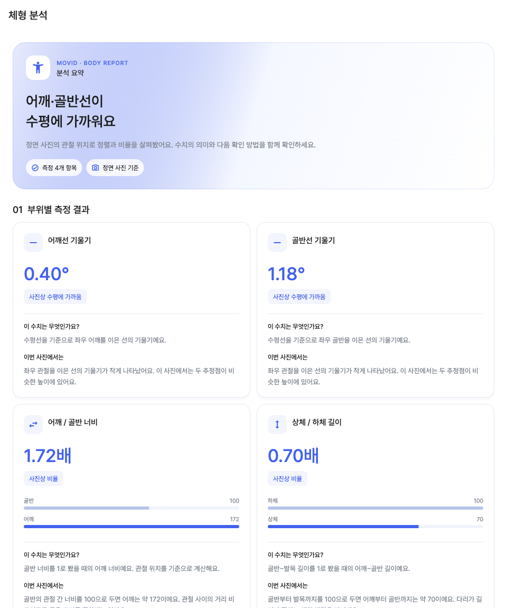
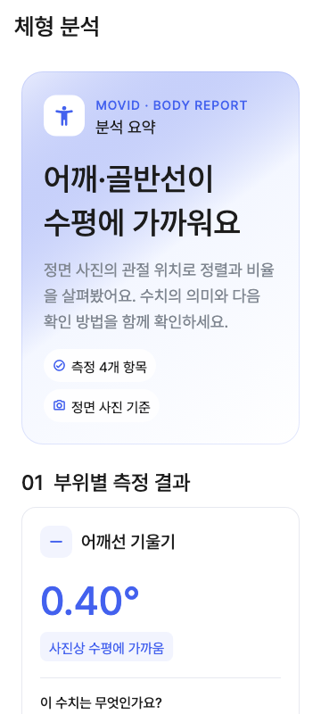

# AI 통합 코드 리뷰 — 2026-10-31

## 범위

첨부 ZIP과 같은 팀 저장소 main(702e91d)을 기준으로, 로컬에 만들어 둔 AI·Spring·Flutter 통합 변경을 검토하고 포함했습니다. 서버 API·분석 화면·macOS 실행 지원이 대상입니다. 실제 근육 분류 학습이나 미구현 운동·커뮤니티 API를 새로 완성한 작업은 아닙니다.

## 수정한 위험

| 문제 | 수정 | 확인 |
| --- | --- | --- |
| `**/data/`가 Flutter 소스까지 누락 | 실행 DB만 `/BE/data/`로 제외 | Git 추적 대상 확인 |
| 잘못된 Base64를 위젯 생성 중 해독하면 화면 중단 | 제한 크기·형식 방어 및 오류 안내 위젯 공통 사용 | 위젯 테스트 |
| 60초 화면 제한과 90초 서버 제한 불일치 | 화면 제한 110초, 같은 분석 ID로 재개 유지 | 85초 pending 후 완료/110초 중단 테스트 |
| 루틴 버튼을 숨겨도 직접 호출 가능 | 지원 여부·dispose 상태를 요청 단계에서 검사 | 서버 요청 미발생 테스트 |
| 누락/비유한 비율의 반올림·표시 오류 | null 유지 및 잘못된 관절점 거절 | Python·Dart 경계 테스트 |
| AI가 HTTP 200을 주면 잘못된 결과도 저장 가능 | 완료 상태·버전·필수 수치·DB 범위를 저장 전 검사 | Java 계약 검증 4개 |
| 권한 검사 전 이미지 읽기, 잘못된 헤더의 서버 오류 | 읽기 전 동의/계정 확인, IOException 입력 오류 처리 | Java 업로드 검사 2개 |
| 이미 종료된 분석이 추론을 시작할 가능성 | pending·유효 시간 확인 후 AI 호출 | 서비스 코드 경로 검토 |
| 기본 테스트가 개발자 MySQL에 의존 | 컨텍스트 검사를 별도 메모리 DB로 분리 | 전체 Gradle test 성공 |
| macOS 생성 시 원래 플랫폼 메타데이터 누락 | Android/iOS 정보를 유지하고 macOS만 추가 | 원본 대비 diff |

## 실행 결과

- Python unittest: 5개 통과.
- Flutter 분석 테스트: 25개 통과. GitHub 업로드용 체크아웃에서 분석·보안 토큰·서버 로그인 저장소·홈 회귀 테스트를 함께 실행해 총 49개 통과.
- Java: 10개 통과, MySQL 전용 40개는 DB_URL 미지정으로 건너뜀. bootJar 성공.
- Flutter analyze: 이번 변경 범위의 오류 없음. 기존 community null-aware 안내 1개, 아이콘 미리보기 테스트의 동적 IconData 경고 1개가 남습니다.
- test1.jpg 실제 로컬 왕복: JWT 로그인 → 사진 업로드 → 분석 ID → MediaPipe·DINOv3 추론 → DB 결과 조회 → 같은 사진 결과 재사용 및 이력 확인 통과.
- 로컬 부정 검사: 잘못된 이미지/요청 거절, 단색 사진 failed 전환, 실패 시 횟수 보존, 다른 계정 조회·삭제 차단, 삭제된 서명 URL 차단 통과.
- 실제 사진 검사는 메모리 H2와 별도 사진 폴더를 사용했습니다. 기존 사용자 DB는 수정하지 않았습니다. 개인 사진·토큰·가중치는 커밋하지 않습니다.

## 실행 및 영향

루트 README_INTEGRATION.md의 순서로 서버를 실행하고 VS Code의 macOS 실제 서버 구성을 선택합니다. Python 3.12, Java 17, 승인된 DINOv3 모델 접근이 필요합니다. Flutter 잠금 파일은 테스트한 Flutter 3.44/Dart 3.12 계열로 갱신되어, 구버전 SDK는 해당 버전으로 맞추거나 기존 의존성 호환을 별도로 검증해야 합니다.

관리자 계정은 분석 횟수 제한이 없고 일반 계정은 하루 3회입니다. 관리자도 사진 보관 한도 20장은 적용됩니다. 기존 분석 결과는 조회 시 설명이 보강됩니다. 새 DB 컬럼은 V4 마이그레이션이 필요합니다. demo는 H2 전용이며 기본 MySQL 설정을 대체하지 않습니다.

## 남은 TODO

- MySQL 환경에서 Flyway V4·JSON 저장·동시 요청을 검증합니다. 현재 잠금·실행기는 단일 서버 시연 용도이며 다중 인스턴스 큐/분산 제한은 미구현입니다.
- 근육 분류기는 학습하지 않았습니다. DINOv3 임베딩과 사진 관절 비율을 근육량·진단·운동 처방으로 해석하지 않습니다.
- 다중 인물·정면·의복 자동 검증, 측면 목 분석, 목표 비교·추천 루틴 API는 후속 작업입니다.
- AI 내부 API는 인증이 없으므로 로컬 또는 제한된 네트워크에 둡니다. 외부 배포의 인증·비밀키·HTTPS·DB 및 저장소 운영 설정은 별도 검토가 필요합니다.
- 기존 전체 화면 골든 테스트의 플랫폼/폰트 차이는 이 범위에서 기준 이미지를 변경하지 않았습니다. 모든 앱 화면을 수동으로 재검증한 것은 아닙니다.

## 화면 예시

아래는 가짜 측정값으로 만든 위젯 렌더 결과이며 실제 사용자 사진이 없습니다.

